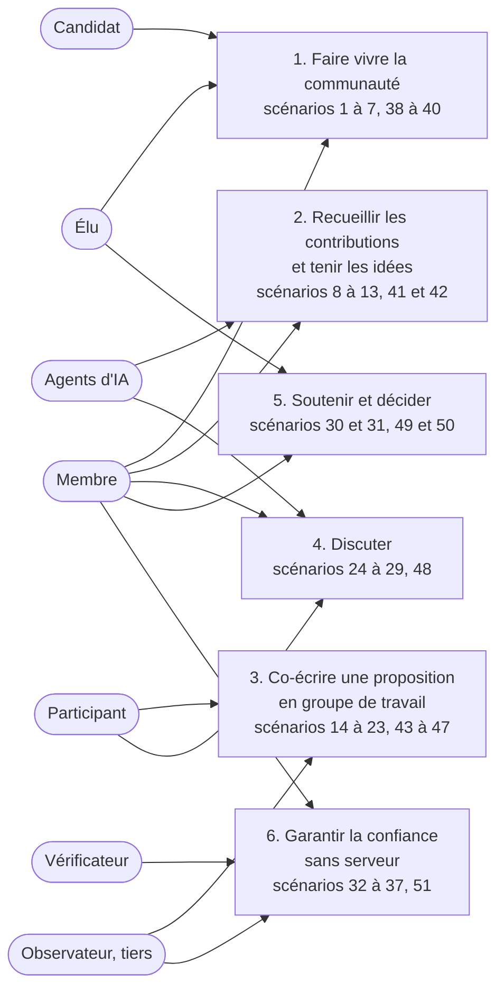

# Remarque générale

Cette analyse applique à reteKuneAgi le formalisme utilisé pour l'étude de cas du meetup du 28 mars 2024 ([[MU Analyse par chat GPT]]) : la phase d'analyse de la méthode 2TUP (*2 Track Unified Process*), qui repose sur les cas d'utilisation. On identifie d'abord les acteurs, les actions, les ressources et les concepts ; on en tire un glossaire métier ; puis on écrit des scénarios d'usage concrets, que l'on regroupe en cas d'utilisation. Écrire les scénarios revient à illustrer par avance le manuel d'utilisation.

Comme pour le meetup, l'analyse a été menée conjointement par l'humain et l'IA. Les scénarios ont été rédigés par un assistant (Claude) à partir des deux notes du projet et doivent être relus : ils portent `metadata_verifiees: false`.

> [!warning] Rien n'est implémenté  
> reteKuneAgi est un projet. Les scénarios décrivent le comportement attendu, pas un logiciel existant. La communauté (la « Coopérative des Tilleuls »), ses membres (Alice, Bob, Chloé, Driss, Émile, Fatou, Gerhard) et leur Problème (sur le manque de stockage sûr des vélos), ainsi que la Proposition d’Action correspondante (utiliser les parkings à vélos mobiles de la mairie) sont inventés pour l'exemple.

# Cahier des charges

Le cahier des charges tient en deux notes :

- [[présentation_reteKuneAgi]] : le projet raconté du point de vue de l'utilisateur, avec quatorze croquis d'écrans ;
- [[reteKuneAgi|KuneReti]] : la conception détaillée (dépôts, fichiers, processus, votes, agents).

En une phrase : faire une version avancée de KuneAgi (Nova-Ideo) **sans serveur central**. Les membres d'une communauté publient des Problèmes ou des Propositions d’Action indexés par un jeu d’étiquettes fixes ; de petits groupes de travail co-écrivent ces Problèmes ou Propositions d’Action par itérations, les amendent et les publient au jugement majoritaire ; tous les membres priorisent les Problèmes publiés par des Jetons de Priorité dont ils disposent en nombre limité et sélectionnent les Propositions d’Action publiées par jugement majoritaire. Tout est fichier Markdown signé, dans des dépôts Git que chacun copie.

::: warn
Le texte initial décrivant la version plus polyvalente KuneReti fonctionne sans horloge centrale.

Il existe pourtant des serveurs libres de temps (fournissant des certificats de temps compatibles avec la norme RFC 3161), comme [freeTSA](https://freetsa.org/index_en.php).  Le présent texte présente donc deux options lorsque c’est pertinent \[entre crochets\] : (1) un serveur de temps est utilisé et sert donc d’horloge centrale, en caractères droits; (2) sans horloge centrale, en *italiques*. Au terme de l’analyse, il semble que seule une version avec une horloge centrale permet de faire fonctionner les votes, qui dépendent pour cela que leurs instants d’ouverture et de clôture soient définis de façon univoque et incontestable. 

:::

# Glossaire métier

Voir [rKA Glossaire métier](https://workspace.cosmopolitical.coop/f/54850).

# Acteurs

| Acteur                                                                                | Nature                                                | Ce qu'il fait                                                                           |
|---------------------------------------------------------------------------------------|-------------------------------------------------------|-----------------------------------------------------------------------------------------|
| Tiers, visiteur                                                                       | Humain, non membre                                    | Lit ce qui est public, vérifie un scrutin                                               |
| Candidat                                                                              | Humain                                                | Rejoint une communauté, attend son admission                                            |
| Membre                                                                                | Humain                                                | Contribue, discute, soutient, vote dans les scrutins de la communauté                   |
| Participant                                                                           | Humain, membre inscrit dans un groupe de travail      | Co-écrit, amende, vote dans son groupe                                                  |
| Observateur                                                                           | Humain, membre non participant                        | Suit un groupe, apporte des arguments, ne vote pas                                      |
| Membre tiré au sort                                                                   | Humain                                                | Vérifie une identité, modère, contrôle la conformité, siège dans un jury                |
| Élu : autorité, trésorier, membre du comité de pilotage ou de l'instance de médiation | Humain, rôle attribué par scrutin                     | Fusionne ce qui est légal, atteste une cotisation, rend des avis, prononce une sanction |
| Fondateur                                                                             | Humain                                                | Crée la communauté, première autorité                                                   |
| Assistant d'amendement                                                                | Modèle de langage, local                              | Propose un regroupement des modifications                                               |
| Agent synthétiseur                                                                    | Modèle de langage                                     | Résume les fils et les itérations                                                       |
| Agent traducteur                                                                      | Modèle de langage                                     | Produit les traductions                                                                 |
| Agent veilleur                                                                        | Modèle de langage                                     | Signale ; ne masque jamais                                                              |
| Exécutant                                                                             | Humain ou tâche planifiée                             | Fait tourner un agent                                                                   |
| Application reteKuneAgi                                                               | Système : mobile, poste de travail, ligne de commande | Cache Git et les clés, signe, synchronise, vérifie                                      |
| Vérificateur                                                                          | Système, hébergé hors des dépôts                      | Refuse toute écriture mal formée, mal signée ou illégale                                |
| Forge                                                                                 | Système externe                                       | Héberge les dépôts ; remplaçable                                                        |

Les personnages des scénarios : **Driss** fonde la communauté et en est une autorité ; **Chloé** la rejoint ; **Alice** et **Bob** participent au groupe « Des vélos partagés » ; **Fatou** lance un groupe concurrent ; **Émile**, Fatou et Driss forment le comité de pilotage.

# Cas d'utilisation

Le parcours nominal d'une proposition enchaîne les scénarios 8 (contribution), 11 (idée), 14 (groupe), 18 à 21 (amendements, votes, publication), 30 (soutiens). Les scénarios 33, 34 et 36 sont des scénarios d'erreur. Les scénarios 38 à 51 ont été ajoutés après relecture des documents historiques de KuneAgi et de Nova-Ideo (voir plus bas).

# Liste des scénarios concrets

## Cas d'utilisation 1 : Faire vivre la communauté

### 1. **Fonder une communauté**

- **Acteur** : Driss, fondateur
- **Scénario** : Driss fonde la communauté de la Coopérative des Tilleuls. Il crée le dépôt de communauté, et y dépose la Charte fondatrice, puis génère la clé racine, publie le dépôt sur deux forges et obtient le QR code qui permettra aux autres de rejoindre la communauté.
- **Fiche** : rKA Scénario 01 Fonder une communauté

### 2. **Rejoindre une communauté**

- **Acteur** : Chloé, candidate
- **Scénario** : Chloé a reçu le QR code de la Coopérative des Tilleuls. Elle le scanne avec l'application mobile, qui clone le dépôt de communauté, vérifie l'empreinte de la clé racine, crée ses clés et dépose sa candidature. Dans le cas d’une admission légère, elle ne fournit que son pseudonyme et ses langues de communication; dans le cas d’une admission robuste, elle fournit son triplet identifiant. Chloé ne peut ni lire quoi que ce soit de non public, ni écrire avant d’être admise.
- **Fiche** : rKA Scénario 02 Rejoindre une communauté

### 3a. **Admettre un candidat en mode léger**

- **Acteur** : néant
- **Scénario** : La candidature de Chloé déclenche le processus d’admission léger. Lors du dépôt de candidature, le système vérifie que (1) Chloé est une personne réelle et (2) le pseudonyme choisi par Chloé n’est pas déjà utilisé par un membre. Lorsque ces vérifications sont faites, Chloé devient membre.
- **Fiche** : rKA Scénario 03b Admettre un candidat en mode léger

### 3b. **Admettre un candidat en mode robuste**

- **Acteur** : Émile et Fatou, vérificateurs tirés au sort
- **Scénario** : La candidature de Chloé déclenche le processus d’admission robuste hérité de KuneAgi. Lors du dépôt de candidature, le système vérifie que (1) Chloé est une personne réelle, (2) le pseudonyme choisi par Chloé n’est pas déjà utilisé par un membre,  et (3)  que le hashcode du triplet identifiant que Chloé a renseigné lors de son inscription est absent de la liste des hashcodes des triplets identifiants des membres existants. Des vérificateurs sont tirés au sort parmi les membres ; ils s'assurent, hors des dépôts, que le triplet identifiant qu’elle a fourni lors de son inscription correspond à celui de ses documents officiels d’identité et qu’elle satisfait les conditions pour être membre de la communauté, puis signent une attestation. Quand assez d'attestations sont réunies \[ou au terme de la durée fixée par la charte / *pas de solution identifiée pour fixer la fin du processus sans horloge*\], Chloé devient membre.
- **Fiche** : rKA Scénario 03b Admettre un candidat en mode robuste

### 3c. **Admettre un candidat lorsque l’Annuaire Distribué est actif**

- **Acteurs** : Les membres “aval” du nouveau membre ; les membres “amont” du nouveau membre ; le nouveau membre 
- **Scénario** : Lorsque le candidat est admis, le système : 
  - chosit d’abord aléatoirement N membres existants (avec N = le nombre de membres “amont” pour chaque membre dans l’Annuaire Distribué, défini dans la charte). Ces N membres seront les membres “aval” du nouveau membre. Pour chacun de ces N membres “aval” du nouveau membre, le système sélectionne aléatoirement un de ses membres “amont”, qui seront les membres “amont” du nouveau membre. Le système met à jour, en fonction de ces changements, dans l’Image de l’Annuaire Distribué,  la liste des pseudonymes des membres “amont” et “aval” concernés ;  
  - envoie dans un message privé (cf. Scénario 27) au nouveau membre : 
    - un fichier (à conserver confidentiel) dans lequel il tiendra à jour les données de sa part d’Annuaire Distribué, et contenant les instructions pour le faire. Ce fichier contient :  les clefs publiques et les pseudonymes de ses N membres “amont”, chacune dans sa case numérotée ; N emplacements vides numérotés dans lesquels il inscrira les adresses de courriel de ses N membres “aval” ;
    - la liste des pseudonymes des N membres “amont” du nouveau membre, avec instruction d’envoyer à chacun, dans un message privé, l’adresse de courriel du nouveau membre ;
    - la liste des pseudonymes des N membres “aval” du nouveau membre, chacun associé avec son numéro de case, avec l’avertissement de l’arrivée d’un message privé légitime provenant de ce membre “aval”, et contenant l’adresse de courriel de ce membre “aval” à inscrire dans la case correspondante de la part d’Annuaire Distribué du nouveau membre ; 
  - envoie dans un message privé à chacun des N membres “aval” du nouveau membre : 
    - le pseudonyme et la clef publique du nouveau membre, avec instruction de mettre à jour la case numérotée correspondant à celui de ses membres “amont” qui a été modifié par l’arrivée du nouveau membre ;
    - l’instruction d’envoyer par message privé au nouveau membre l’adresse de courriel du membre “aval” concerné ;
  - envoie dans un message privé à chacun des N membres “amont” du nouveau membre : 
    - le pseudonyme du nouveau membre ;
    - l’avertissement de l’arrivée d’un message légitime provenant du nouveau membre avec une nouvelle adresse de courriel à insérer dans sa part de l’Annuaire Distribué ;
    -  le numéro de la case, dans la liste de ses propres membres “aval”, à mettre à jour avec cette adresse de courriel du nouveau membre.

Le nouveau membre, ses membres “amont” et ses membres “aval”, exécutent les instructions reçues du système. 

- **Fiche** : rKA Scénario 03c. Admettre un candidat lorsque l’Annuaire Distribué est actif

### 4. **Retrouver sa qualité de membre après la perte de ses clés**

- **Acteur** : Bob, membre
- **Scénario** : Bob a perdu son téléphone et n'a pas conservé sa phrase de secours. Il n'existe pas de guichet « mot de passe oublié ». Dans le mode d’admission léger, il peut se réinscrire immédiatement, à condition d’utiliser un autre pseudonyme. Dans le mode d’admission robuste, il doit attendre que la quarantaine soit finie (cf. scénario 38 ci-dessous) pour se réinscrire. Dans les deux cas, il doit choisir un nouveau pseudonyme et la connexion avec son historique est perdue. 
- **Fiche** : rKA Scénario 04 Retrouver sa qualité de membre après la perte de ses clés

### 5. **Modifier la charte par un scrutin scellé**

- **Acteur** : Alice, membre, puis tous les membres
- **Scénario** : Alice propose de porter de sept à neuf le nombre de jetons par membre. La charte est un texte comme un autre : elle se modifie par un scrutin de toute la communauté. Pour que les premiers résultats n'influencent pas les derniers votants, les bulletins sont scellés pendant le vote, puis révélés après la clôture.
- **Fiche** : [[KR Scénario 05 Modifier la charte par un scrutin scellé]]

### 7. **Relier deux communautés**

- **Acteur** : Driss, membre des Tilleuls
- **Scénario** : À l’initiative de Driss, la Coopérative des Tilleuls vote sur l’ouverture de l’accès en lecture à ses contenus (Problèmes, Propositions d’Action) à l’association des Jardins du Canal. Si le vote est positif \[au terme de la durée fixée par la charte / *pas de solution identifiée pour fixer la fin du processus sans horloge*\], la communauté inscrit dans son dépôt un lien signé vers le dépôt de l’association des Jardins du Canal. Il n'y a pas d'annuaire : la fédération est la somme de ces liens. Il n’y a pas d’obligation de réciprocité : l’association des Jardins du Canal n’est pas obligée d’ouvrir ses contenus en lecture à  la Coopérative des Tilleuls.
- **Fiche** : rKA Scénario 07 Relier deux communautés

### 38a. **Quitter la communauté**

- **Acteur** : Bob, membre
- **Scénario** : Bob quitte la Coopérative des Tilleuls. Il confirme sa démission après un délai de réflexion \[au terme de la durée fixée par la charte / *lors de son deuxième passage sur l’interface de démission*\] ; sa clé est révoquée, il sort de ses groupes et ses jetons sont retirés. Ce qu'il a écrit reste attribué à son pseudonyme : un historique signé et copié ne s'efface pas. Une quarantaine l'empêche de revenir aussitôt sous une identité vierge et un nouveau pseudonyme.
- **Fiche** : rKA Scénario 38 Quitter la communauté

### 38b. **Quitter la communauté lorsque l’Annuaire Distribué est actif**

- **Acteurs** : Les membres “aval” du membre démissionnaire ; les membres “amont” du membre démissionnaire
- **Scénario** : Lorsque le membre quitte la communauté, le système : 
  - envoie dans un message privé à chacun des N membres “aval” du membre démissionnaire :
    - le pseudonyme et la clef publique du membre “amont” du membre démissionnaire portant le même numéro de case (c’est à dire que le membre “aval” n°k du membre démissionnaire est associé au membre “amont” n°k de ce même membre démissionnaire), qui est substitué au membre démissionnaire, et qui devient donc son nouveau membre “amont” ;
    - l’instruction de mettre à jour dans sa part d’Annuaire Distribué, avec le pseudonyme et la clef publique de son nouveau membre “amont“, la case numérotée, parmi ses propres membres “amont”, correspondant au membre démissionnaire ;
    - l’instruction d’envoyer par message privé à ce nouveau membre “amont” sa propre adresse de courriel (à savoir celle du membre “aval” concerné du membre démissionnaire) ;
  - envoie dans un message privé à chacun des N membres “amont” du membre démissionnaire : 
    - le pseudonyme du membre “aval” du membre démissionnaire portant le même numéro de case (c’est à dire que le membre “amont” n°k du membre démissionnaire est associé au membre “aval” n°k de ce même membre démissionnaire), qui est substitué au membre démissionnaire, et qui devient donc son nouveau membre “aval” ;
    - l’avertissement de l’arrivée d’un message légitime provenant de ce nouveau membre “aval“ pour mise à jour de sa part d’Annuaire Distribué ;
    - l’instruction, à la réception du message privé contenant cette adresse de courriel de la part de son nouveau membre “aval”, de mettre à jour, avec cette adresse de courriel, la case numérotée, parmi ses propres membres “aval”, correspondant au membre démissionnaire, dans sa part d’Annuaire Distribué.

Les membres “amont” et les membres “aval” du membre démissionnaire, exécutent les instructions reçues du système. 

- **Fiche** : rKA Scénario 03c. Admettre un candidat lorsque l’Annuaire Distribué est actif

### 39. **Gérer son profil**

- **Acteur** : Chloé, membre
- **Scénario** : Chloé complète son profil. Les autres membres ne voient que ce que porte sa fiche : son pseudonyme, un texte de présentation, un avatar, ses langues, ses rôles et ses groupes. Ses centres d'intérêt et ses réglages restent sur son téléphone. Elle peut choisir de lever son pseudonymat, par exemple pour se porter candidate à un comité.
- **Fiche** : [[KR Scénario 39 Gérer son profil]]

### 40. **Suspendre et rétablir les droits d'un membre**

- **Acteur** : Application où s’effectue le paiement, ou le trésorier élu, puis Alice, membre
- **Scénario** : La Coopérative des Tilleuls réserve le vote aux membres à jour de leur cotisation. Celle d'Alice est échue. \[Cet événement est détecté parce que le logiciel tournant sur le dépôt de la communauté compare la date courante fournie par l’horloge centrale à celle de fin de validité de la cotisation d’Alice / *pas de solution identifiée pour détecter cette fin de validité de cotisation sans horloge*\] : ses droits de vote sont suspendus, puis rétablis dès qu'elle a payé. Cela est manuel ou automatisé : la date de validité est inscrite dans la fiche d'Alice par l’application où s’effectue le paiement ou par le trésorier élu, et chaque application en tire la conséquence.
- **Fiche** : rKA Scénario 40 Suspendre et rétablir les droits d'un membre

## Cas d'utilisation 2 : Faire une veille des contenus publiés

### 42. **Rechercher et suivre ses centres d'intérêt**

- **Acteur** : Bob, membre
- **Scénario** : Bob cherche ce qui s'est dit sur le stationnement. Cela relève des étiquettes “Transports” et “Urbanisme”. Il recherche sur son téléphone le résultat de l’application du filtre “Transports” ET “Urbanisme” sur les contenus existants. Comme il souhaite suivre cette question, il mémorise sa recherche (la phrase logique reliant ces deux étiquettes) comme centre d'intérêt. Désormais, son application l'alertera quand un Problème ou une Proposition d’Action y répondra.
- **Fiche** : rKA Scénario 42 Rechercher et suivre ses centres d'intérêt

## Cas d'utilisation 3 : Co-écrire un Problème ou une Proposition d’Action en groupe de travail

### 14a. **Créer la première version d’un Problème ou d’une Proposition d’Action**

- **Acteur** : Alice, membre
- **Scénario** : Alice souhaite soulever un Problème ou faire une Proposition d’Action - par exemple, elle soulève le Problème “Les vélos se rendant à la Coopérative des Tilleuls ne peuvent pas être stockés au sec et en sécurité”. Elle choisit sur l’application si elle souhaite créer un document de Problème  ou de Proposition d’Action. Cela ouvre un modèle de texte (venant du dépôt de la communauté) correspondant à la nature de texte qu’elle écrit (Problème ou Proposition d’Action). Alice écrit son ébauche de texte sur son ordinateur ou son téléphone, en répondant aux questions que le modèle lui pose pour l’aider à réfléchir. Lorsqu’elle écrit une Proposition d’Action, elle doit la rattacher à au moins un Problème publié. Lorsqu’elle est satisfaite de sa première version, ou quand elle n’arrive plus à aller plus loin, elle publie son contenu, ce qui le soumet à la Modération distribuée (Scénario 41). 
- **Fiche** : rKA Scénario 14a Créer la première version d’un Problème ou d’une Proposition d’Action

### 41. **Modérer de façon distribuée un contenu avant sa publication**

- **Acteur** : Trois membres tirés au sort
- **Scénario** : La charte des Tilleuls prévoit que tout nouveau contenu est modéré avant d'être affiché. Le contenu (Problème ou la Proposition d’Action) d’Alice est soumis à trois membres tirés au sort. Ils ne jugent pas le fond, seulement le respect des personnes et de la charte. S'ils ne disent rien \[au terme de la durée fixée par la charte / *pas de solution identifiée pour fixer la fin du processus sans horloge*\], le contenu est publié. Un refus doit citer le passage en cause et la règle enfreinte.
- **Fiche** : rKA Scénario 41 Modérer de façon distribuée un contenu avant sa publication

### 14b. **Ouvrir un groupe de travail**

- **Acteur** : Alice, membre
- **Scénario** : Une fois le contenu d’Alice validé par la modération distribuée, l’application ouvre le groupe de travail : un dépôt est créé, la première version du contenu (Problème ou la Proposition d’Action) d’Alice. Alice choisit les caractéristiques du groupe de travail : son mode de contrôle de sa composition (a priori, a posteriori, les deux), ainsi que le mode d’écriture collaborative lors de la première itération (mode wiki par défaut), ainsi que la durée du premier cycle de modifications. Le groupe est recensé dans le dépôt de communauté et attend ses participants. Lorsque le groupe de travail atteint son quorum, fixé par le dépôt de la communauté, il devient actif et capable d’amender le contenu initial proposé par Alice.
- **Fiche** : rKA Scénario 14b Ouvrir un groupe de travail

### 15. **Rejoindre ou quitter un groupe de travail**

- **Acteur** : Bob puis Chloé, membres
- **Scénario** : Bob rejoint le groupe portant sur le Problème “Les vélos se rendant à la Coopérative des Tilleuls ne peuvent pas être stockés au sec et en sécurité”. Dans le cas où le groupe de travail a choisi de contrôler sa composition a priori, il n’est admis que si la majorité qualifiée des participants existants l’accepte (cf. Scénario 44). Chloé arrive quand le groupe compte déjà douze participants : elle s'inscrit sur la liste d'attente. Quand un participant quitte le groupe : les participants restants attribuent une note de comportement coopératif au participant quittant le groupe et celui-ci attribue une note de comportement coopératif à chacun des participants restants (Scénario 45), le premier membre de la liste d’attente, s’il existe, prend sa place, après vote des participants existants (si le groupe a choisi de contrôler sa composition a priori - cf. Scénario 44).
- **Fiche** : rKA Scénario 15 Rejoindre ou quitter un groupe de travail

### 16. **Modifier le texte en mode wiki**

- **Acteur** : Alice, participante
- **Scénario** : Le groupe travaille en mode wiki. Alice rédige la section « Financement » ; chaque modification qu'elle enregistre produit une nouvelle version, sans validation. Le vote de publication portera sur une version précise, désignée par son empreinte : une retouche de dernière minute donne une autre version, sur laquelle personne n'a voté.
- **Fiche** : [[KR Scénario 16 Modifier le texte en mode wiki]]

### 18. **Préparer et soumettre un amendement**

- **Acteur** : Alice, participante, aidée de l'assistant d'amendement
- **Scénario** : Le groupe travaille en mode avec amendements. Alice a modifié la proposition dans sa copie pour élargir le service aux vélos cargo, et en a profité pour reformuler quelques phrases. Avant de soumettre, elle doit regrouper ses modifications par intention et justifier chacune. Un assistant, qui tourne sur son poste et ne lit que sa copie, lui propose un regroupement ; Alice corrige, décide et signe.
- **Fiche** : [[KR Scénario 18 Préparer et soumettre un amendement]]

### 19. **Voter les amendements au jugement majoritaire**

- **Acteur** : Bob, participant
- **Scénario** : L'itération est échue \[au terme de la durée fixée par la charte / *pas de solution identifiée pour fixer la fin du processus sans horloge*\]. Les amendements qui portent sur les mêmes passages sont regroupés en un seul scrutin et votés les uns contre les autres et contre le texte d'origine. Bob attribue à chaque version l'une des sept mentions, de « Excellent » à « À rejeter ». Son bulletin est un fichier signé \[et daté / *non daté*\]. 
- **Fiche** : [[KR Scénario 19 Voter les amendements au jugement majoritaire]]

### 20. **Dépouiller le scrutin de Jugement Majoritaire et produire la nouvelle version**

- **Acteur** : Les participants et le vérificateur
- **Scénario** : Le scrutin se clôt \[au terme de la durée fixée par la charte / *pas de solution identifiée pour fixer la fin du processus sans horloge*\]. La liste des bulletins reçus est figée, puis le dépouillement est calculé : la version retenue est celle dont la mention médiane est la meilleure. En l’absence de jugement sur un amendement, le texte d’origine est conservé par défaut. Les jugements sur chaque amendement sont représentés par une visualisation en couleurs (chaque note ayant une couleur) sous forme d’une barre horizontale, en ordre croissant d’approbation et faisant apparaître la médiane sous forme d’une droite verticale (voir un exemple sur [cette page](https://mieuxvoter.fr/presse/mj-tracker-2027) de l’association “Mieux voter”). L’intersection de la droite verticale avec le graphique représentant les jugements reçus par chaque amendement fait apparaître la médiane, et rend ainsi visible la justification du choix. De surcroît, chaque participant peut refaire le calcul sur son téléphone ou son ordinateur. Les amendements retenus sont alors appliqués, ce qui produit la nouvelle version.
- **Fiche** : rKA Scénario 20 Dépouiller le scrutin et produire la nouvelle version

### 21. **Clore l'itération : publier ou continuer**

- **Acteur** : Les participants du groupe
- **Scénario** : Les amendements sont dépouillés et la nouvelle version est produite. Le groupe vote sur trois éléments: (1) entre (a) publier le contenu et donc le soumettre à la priorisation (pour les Problèmes) ou au jugement (pour les Propositions d’Action) à toute la communauté et (b) continuer le travail par un nouveau tour d’amendements; (2) si le choix est fait de continuer le travail, sur durée de l'itération suivante; (3) si le choix est fait de continuer le travail, sur le mode de travail (wiki ou avec amendements) de cette itération suivante. \[Au terme de la durée fixée par la charte / *pas de solution identifiée pour fixer la fin du processus sans horloge*\], ces votes sont clos. Si le groupe vote pour la poursuite du travail, alors une nouvelle itération de modification du texte commence. Si le groupe vote en faveur de la publication du contenu: les participants s’attribuent mutuellement des notes de comportement coopératif (Scénario 45), le contenu est soumis au contrôle de conformité (Scénario 47),  le nombre de groupes de travail de chaque participant est diminué de 1 (ce qui lui libère de la capacité pour participer à un nouveau groupe de travail s’il avait atteint son nombre maximal).
- **Fiche** : rKA Scénario 21 Clore l'itération : publier ou continuer

### 22. **Dupliquer une proposition**

- **Acteur** : Fatou, membre
- **Scénario** : Fatou ne partage pas l'orientation prise par le groupe autour du Problème “Les vélos se rendant à la Coopérative des Tilleuls ne peuvent pas être stockés au sec et en sécurité”, qui a écarté les vélos-cargos et les tricycles couchés. Elle n’est pas parvenue à convaincre les autres participants de voter pour ses propositions d’amendement allant dans ce sens, et considère que c’est très important pour elle. Plutôt que de perdre son temps dans ce groupe à y défendre une cause perdue, elle copie le dépôt du groupe, avec tout son historique, et ouvre un groupe concurrent, sans bloquer ou perturber le groupe précédent. Les deux propositions seront soumises au soutien de tous.
- **Fiche** : rKA Scénario 22 Dupliquer une proposition

### 23. **Fusionner deux Problèmes concurrents**

- **Acteur** : Émile, membre, puis les deux groupes
- **Scénario** : Deux fomulations de Problème, concurrentes, sur le stationnement des vélos (celles d’Alice et celle de Fatou) ont été publiées et se partagent les Jetons de Priorité. Émile propose de les réunir. Il ouvre un groupe de fusion à partir des deux dépôts, qui ont un ancêtre commun : les sections identiques sont reprises, les sections divergentes sont présentées côte à côte et deviennent des amendements concurrents, tranchés par le vote lors de la première itération.
- **Fiche** : rKA Scénario 23 Fusionner deux Problèmes concurrents

### 44. **Admettre ou exclure un participant par un vote du groupe**

- **Acteur** : Les participants du groupe
- **Scénario** : Le groupe « Des vélos partagés » a choisi de contrôler sa composition a priori et a posteriori. Quand Chloé demande à y entrer et qu’il reste de la place dans le groupe (le nombre maximal de participants n’a pas encore été atteint), les participants votent sur son entrée, en regardant en particulier sa Note de Comportement Coopératif (déterminée par le Scénario 45). \[Au terme de la durée fixée par la charte / *pas de solution identifiée pour fixer la fin du processus sans horloge*\], le vote est clos et dépouillé, et Chloé est admise si elle a reçu plus d’une majorité qualifiée des voix exprimées. Plus tard, Alice, qui sabote le travail fait l'objet d'un vote d'exclusion, auquel elle ne prend pas part. \[Au terme de la durée fixée par la charte / *pas de solution identifiée pour fixer la fin du processus sans horloge*\], le vote est clos et dépouillé, et Alice est exclue du groupe si plus d’une majorité qualifiée des voix exprimées a voté en ce sens. Alice note le Comportement Coopératif des participants restant dans le groupe, et chacun des participants restant dans le groupe note le Comportement Coopératif d’Alice (Scénario 45).  Une décision prise vaut pour une durée fixée : on ne revote pas la même chose le lendemain.
- **Fiche** : rKA Scénario 44 Admettre ou exclure un participant par un vote du groupe

### 45. **Apprécier le comportement coopératif de ses pairs à la sortie d'un groupe**

- **Acteur** : Les participants d'un groupe
- **Scénario** : Alice quitte le groupe autour du Problème “Les vélos se rendant à la Coopérative des Tilleuls ne peuvent pas être stockés au sec et en sécurité”, dont le travail est achevé. Chaque participant apprécie alors le comportement coopératif des autres : meilleur qu'attendu, conforme, ou inférieur. Les appréciations nourrissent une note visible dans le profil de chacun, qui s'efface avec le temps, avec une durée de demi-vie définie dans la charte.
- **Fiche** : rKA Scénario 45 Apprécier ses pairs à la sortie d'un groupe

### 46a. **Constater l'inactivité d'un participant dans un groupe**

- **Acteur** : Fatou, participante
- **Scénario** : \[Le système compare la date actuelle fournie par l’horloge commune avec la date de la dernière contribution de Bob (vote ou amendement) au Problème “Les vélos se rendant à la Coopérative des Tilleuls ne peuvent pas être stockés au sec et en sécurité” et constate qu’elle est supérieure à la durée fixée d’inactivité maximale d’un participant dans un groupe /  *Fatou constate que Bob n’a pas fait de contribution (vote ou amendement) au groupe autour du Problème “Les vélos se rendant à la Coopérative des Tilleuls ne peuvent pas être stockés au sec et en sécurité” depuis la durée fixée d’inactivité maximale d’un participant dans un groupe. Elle demande l’éviction de Bob. Le système vérifie que la date de dernière contribution de Bob au groupe de travail remonte à une durée supérieure à cette durée, et donc que la demande est légale. Si c’est le cas,*\] Bob est évincé du groupe de travail : il en est informé et la première personne sur la liste d’attente, si elle existe, est admise dans le groupe (après contôle a priori de la composition du groupe, le cas échéant - cf. Scénario 44) et en est informée. 
- **Fiche** : rKA Scénario 46a Constater l'inactivité d'un participant dans un groupe

### 46b. **Constater l'inactivité d'un groupe**

- **Acteur** :  Émile, membre
- **Scénario** : \[Le système compare la date actuelle fournie par l’horloge commune avec la date de dernière activité du groupe animé par Chloé autour du Problème “Les vélos se rendant à la Coopérative des Tilleuls ne peuvent pas être stockés au sec et en sécurité” (nombre de participants inférieur au quorum, adoption d’une nouvelle version du Problème, publication du Problème) et constate qu’elle est supérieure à la durée fixée d’inactivité maximale d’un participant dans un groupe / *Émile constate que le groupe animé par Chloé autour du Problème “Les vélos se rendant à la Coopérative des Tilleuls ne peuvent pas être stockés au sec et en sécurité” n’a pas eu d’activité (nombre de participants inférieur au quorum, adoption d’une nouvelle version du Problème, publication du Problème) depuis la durée fixée d’inactivité maximale d’un groupe. Il demande la clôture du groupe. Le système vérifie que la date de dernière activité du groupe (date de création du groupe, date où le quorum a été atteint pour la dernière fois, date de dernière version du Problème) remonte à une durée supérieure à cette durée, et donc que la demande est légale. Si c’est le cas*,\] le groupe de travail est clos : tous ses participants en sont informés; tous ses participants s’attribuent mutuellement une note de Comporetement Coopératif (Scénario 45); le nombre de groupes de travail auxquels ils participent est diminué de 1 (ce qui leur ouvre la possibilité de participer à un nouveau groupe de travail, dans la limite du nombre maximal de groupes de travail auxquels un même membre peut participer) ; l’archive du groupe de travail reste disponible et son contenu peut être repris par une nouvelle création de groupe à tout moment (Scénario 22 Dupliquer un groupe)  
- **Fiche** : rKA Scénario 46b Constater l'inactivité d'un groupe

### 47. **Contrôler la conformité d'une proposition avant sa soumission**

- **Acteur** : Des membres tirés au sort
- **Scénario** : Le groupe a voté la publication de sa proposition. Avant qu'elle soit soumise au soutien de tous, des membres tirés au sort contrôlent deux choses : qu'elle respecte les principes de la communauté, et qu'elle cite les textes dont elle reprend des passages. Ils ne jugent pas l'opportunité de la proposition : cela, ce sont les jetons et le comité qui le diront. S'ils ne disent rien \[au terme de la durée fixée par la charte / *pas de solution identifiée pour fixer la fin du processus sans horloge*\], le contenu est publié. Un refus doit citer le passage en cause et la règle enfreinte.
- **Fiche** : rKA Scénario 47 Contrôler la conformité d'une proposition avant sa soumission

## Cas d'utilisation 4 : Discuter

### 24. **Discuter d'un contenu**

- **Acteur** : Bob et Alice, membres
- **Scénario** : Bob ne comprend pas le second paragraphe de la section « Financement ». Il écrit un message sur cette section ; Alice lui répond. Chaque message est un petit fichier signé qui dit de quoi il parle et à quoi il répond. Ce n'est pas une messagerie instantanée : un message part à la synchronisation de l'un et arrive à celle de l'autre.
- **Fiche** : [[KR Scénario 24 Discuter d'un contenu]]

### 25. **Consulter ses notifications**

- **Acteur** : Alice, membre
- **Scénario** : Alice ouvre l'application le matin. Aucun serveur ne lui a rien poussé : son téléphone se synchronise, regarde ce qui a changé depuis la veille dans les dépôts qu'elle suit, et en déduit ce qui la concerne.
- **Fiche** : [[KR Scénario 25 Consulter ses notifications]]

### 26. **Synthétiser un fil de discussion**

- **Acteur** : Agent synthétiseur
- **Scénario** : Le fil sur le financement dépasse soixante messages. L'agent synthétiseur en rédige un résumé : les positions en présence, qui les tient, et ce qu'aucun amendement ne couvre encore. La synthèse est toujours affichée comme écrite par une machine. Elle n'arbitre pas et ne recommande aucun vote.
- **Fiche** : [[KR Scénario 26 Synthétiser un fil de discussion]]

### 27. **Envoyer un message privé à un autre membre de la communauté**

- **Acteur** : Alice et Bob, membres
- **Scénario** : Alice veut dire à Bob, sans que qui que ce soit ne le lise, qu'elle trouve son amendement prématuré. Son application chiffre le message pour la clé publique de Bob et pour la sienne, puis le dépose sur le dépôt de la communauté sur la liste des messages destinés à Bob. Le dépôt de la communauté ne révèle que l'existence du message et sa taille.
- **Fiche** : rKA Scénario 27 Envoyer un message privé à un autre membre de la communauté

### 28. **Signaler un contenu et le faire juger**

- **Acteur** : Chloé, membre, puis un jury tiré au sort
- **Scénario** : Chloé lit dans un fil un message insultant. Si le nombre de signalements faits par Chloé au cours des derniers 7 jours est inférieur au nombre maximal fixé par la charte, elle le signale. Il n'y a pas de modérateur attitré : un jury est tiré au sort parmi les membres et vote sur la décision de maintenir le message ou de le masquer. Masquer n'est pas effacer : le message n'est plus affiché, mais il reste dans l'historique. S'ils ne disent rien \[au terme de la durée fixée par la charte / *pas de solution identifiée pour fixer la fin du processus sans horloge*\], le contenu est maintenu publié. Une décision de masquage doit citer le passage en cause et la règle enfreinte.
- **Fiche** : KR Scénario 28 Signaler un contenu et le faire juger

### 29. **Modifier un contenu dans un groupe multilingue**

- **Acteur** : Gerhard, participant germanophone; Agent traducteur
- **Scénario** : Gerhard veut modifier la formulation, écrite en français, du Problème “Les vélos se rendant à la Coopérative des Tilleuls ne peuvent pas être stockés au sec et en sécurité”.  L'agent traducteur produit une version allemande de chaque section. La traduction porte l'empreinte du texte qu'elle traduit : dès que l'original change, elle est signalée comme périmée. Seule la langue du groupe fait foi.  
  Gerhard modifie la version allemande du texte. À la demande de Gerhard, lorsqu’il a fini, l’agent traducteur traduit en français toutes les sections amendées par Gerhard. Gerhard modifie la version française de son texte amendé s’il le souhaite (par exemple, s’il a suffisamment de connaissance du français pour relire et valider, mais pas assez pour rédiger de façon précise et rigoureuse), valide la version en français de son texte, puis soumet celle-ci au processus de modification (wiki ou par amendements) utilisé lors de ce cycle du groupe de travail. 
- **Fiche** : rKA Scénario 29 Modifier un contenu dans un groupe multilingue

## Cas d'utilisation 5 : Soutenir et sélectionner

### 30a. **Prioriser un Problème**

- **Acteur** : Chloé, membre
- **Scénario** : Le Problème “Les vélos se rendant à la Coopérative des Tilleuls ne peuvent pas être stockés au sec et en sécurité” est soumis à la communauté. Chloé veut l’inclure parmi ses priorités , mais ses sept Jetons de Priorité sont tous posés : elle doit en reprendre un ailleurs pour le placer ici. Poser un jeton, c'est signer. Les déplacements sont conservés, ce qui montre l'évolution des priorités dans le temps. Les pseudonymes des membres ayant apporté leur Jeton de Priorité au Problème, ainsi que le numéro d’ordre du Jeton de Priorité du membre alloué à ce Problème, sont visibles de tous les autres membres. Pour chaque membre, la liste des Problèmes auxquels il a apporté ses Jetons de Priorité, avec le numéro du Jeton affecté à chaque Problème, est visible de tous les autres membres.
- **Fiche** : rKA Scénario 30a Prioriser un Problème

### 30b. **Porter un jugement sur une Proposition d’Action**

- **Acteur** : Driss, membre
- **Scénario** : La Proposition d’Action “Louer un garage à vélos mobile à la municipalité” répondant au Problème “Les vélos se rendant à la Coopérative des Tilleuls ne peuvent pas être stockés au sec et en sécurité” est soumise à la communauté. Driss a un avis mitigé sur cette Proposition d’Action, car ill a une mauvaise expérience de ces garages à vélos mobiles. Il juge cette Proposition d’Action et lui attribue une note “Passable”.  La note de Driss est stockée sur le compte de Driss et sur le document de la Proposition d’Action.
- **Fiche** : rKA Scénario 30b Porter un jugement sur une Proposition d’Action

### 31. **Sélectionner une Proposition d’Action**

- **Acteur** : Émile, Fatou et Gerhard, membres du groupe de travail autour de la Proposition d’Action “Louer un garage à vélos mobile à la municipalité”; Driss, membre
- **Scénario** : \[Le système, lors d’une tâche de fond périodique / *Émile*\] constate que : (1) le Problème “Les vélos se rendant à la Coopérative des Tilleuls ne peuvent pas être stockés au sec et en sécurité” a reçu le nombre de Jetons de Priorité minimum fixé par la Charte de la communauté, (2) la Proposition d’Action “Louer un garage à vélos mobile à la municipalité” est sélectionnée par Jugement Majoritaire parmi toutes les Propositions d’Action concurrentes pour répondre à ce Problème, et (3) cette Proposition d’Action a reçu une note médiane supérieure la note médiane requise par cette même Charte. \[(Rien)/ *Il demande à ce que système valide la sélection de cette Proposition d’Action. Le système vérifie que les conditions sont vérifiées. Si c’est le cas,*\] cette Proposition d’Action est sélectionnée. Les résultats du Jugement Majoritaire sont affichés de la même manière que dans le Scénario 20, et tout membre peut refaire le calcul dans son propre téléphone ou ordinateur. Le système : (1) enregistre la Proposition d’Action comme sélectionnée; (2) informe tous les membres de la communauté de ce résultat; (3) informe les membres qui étaient participants du groupe de travail lorque celui-ci a publié cette Proposition d’Action qu’ils ont l’option de participer à son Équipe de mise en œuvre; (4) restitue à son propriétaire chacun des Jetons de Priorité qui avaient été attribués au Problème. Émile, Fatou et Gerhard, qui faisaient partie du groupe de travail lorsque la Proposition d’Action a été publiée, acceptent de participer à cette Équipe de mise en œuvre. Leur pseudonymes sont inscrits dans la liste des membres de l’Équipe de mise en œuvre. Cette Équipe de mise en œuvre travaille dans un cadre autre que reteKuneAgi, par exemple un espace de travail partagé comme NextCloud (en effet, l’unique objet de reteKuneAgi est d’élaborer et de sélectionner les actions engageant les ressources d’un collectif, pas de les réaliser une fois sélectionnées). L’Équipe utilise également un autre canal pour diffuser l’information sur la réalisation ultérieure de la Proposition d’Action. \[Le système compare la date actuelle fournie par l’horloge commune avec la date où la Proposition d’Action a été séléctionnée (et donc où l’appel a été fait aux anciens participants du groupe de travail qui l’a publiée de participer à son Équipe de mise en œuvre). Si la différence est supérieure à la durée fixée dans la charte et si aucun ancien participant à ce groupe  n’accepte de faire partie de l’Équipe de mise en œuvre /  *Si aucun ancien participant à ce groupe  n’accepte de faire partie de l’Équipe de mise en œuvre au terme de la durée fixée par la Charte, Driss demande à désélectionner la Proposition d’Action. Le système vérifie que les conditions de désélection sont bien satisfaites. Si c’est le cas,* \] le système :  (1) enregistre la Proposition d’Action comme désélectionnée, (2) informe tous les membres de la communauté de ce résultat, (3) archive la Proposition d’Action. Elle pourra être dupliquée ultérieurement (Scénario 22).
- **Fiche** : rKA Scénario 31 Sélectionner une Proposition d’Action

## Cas d'utilisation 6 : Garantir la confiance sans serveur

### 32. **Travailler hors ligne et échanger sans forge**

- **Acteur** : Alice et Bob, participants
- **Scénario** : La forge de la communauté est indisponible, et Alice passe trois jours sans réseau. Elle continue de lire, d'écrire et de préparer son vote. À son retour, elle remet ses fichiers signés à Bob sur une clé USB ; Bob les vérifie et les intègre à sa copie. Aucune forge n'était nécessaire.
- **Fiche** : [[KR Scénario 32 Travailler hors ligne et échanger sans forge]]

### 33. **Refuser une fusion illégale**

- **Acteur** : Vérificateur
- **Scénario** : Une autorité du groupe, pressée ou de mauvaise foi, tente de fusionner un amendement que le scrutin n'a pas retenu. Elle détient le bouton de fusion ; elle ne détient pas la décision. Le vérificateur, hébergé hors du dépôt et épinglé, constate qu'aucun scrutin dépouillé ne justifie la transition et refuse. Si l'autorité passe outre, chaque application le voit.
- **Fiche** : [[KR Scénario 33 Refuser une fusion illégale]]

### 51. **Faire vérifier un scrutin par un tiers**

- **Acteur** : Un tiers, extérieur à la communauté
- **Scénario** : Une journaliste veut vérifier que la charte des Tilleuls a bien été modifiée par le vote que la coopérative annonce. Elle n'est pas membre. Elle copie le dépôt public de la communauté, y lance les outils de vérification et refait le dépouillement. Elle n'apprend l'identité de personne : il n'y a que des pseudonymes.
- **Fiche** : [[KR Scénario 51 Faire vérifier un scrutin par un tiers]]

### 52. **Reconstituer la communauté en cas de disparition de toutes les forges**

- **Acteur** : Fatou, membre
- **Scénario** : Toutes les forges de la communauté ont disparu, y compris celles contenant le dépôt de la communauté. L’Annuaire Distribué avait été activé. Fatou, qui détient une part de l’Annuaire Distribué, prend l’initiative de recréer le dépôt d’une nouvelle communauté (Scénario 1). Elle transmet par courriel le lien vers ce nouveau dépôt vers les 5 membres “aval” dont elle a l’adresse de courriel dans sa part de l’Annuaire Distribué, en incluant son pseudonyme et sa clef publique avec mission pour eux de (1) vérifier que le pseudonyme et la clef publique du courriel qu’elle leur envoie correspondent bien à l’une de leurs 5 combinaisons de pseudonyme + clef publique “amont”, et si oui de (2) rediffuser le lien vers ce nouveau dépôt auprès de leurs 5 membres “aval” respectifs dont ils ont l’adresse de courriel, en y ajoutant leur pseudonyme et leur clef publique,  et (3) de s’inscrire sur ce nouveau dépôt. 
- **Fiche** : rKA Scénario 52. Reconstituer la communauté en cas de disparition de toutes les forges

# Ce que l'écriture des scénarios a fait apparaître

Écrire un scénario oblige à dire ce que les notes de conception laissaient dans le flou. Les points suivants ont été **supposés** pour pouvoir dérouler les étapes ; ils sont à confirmer ou à corriger, et plusieurs méritent une décision de conception.

 1. **Fondation (scénario 1).** Le dépôt de contenus (Problèmes et Propositions d’Action) est créé en même temps que le dépôt de communauté, et le fondateur est la première autorité.
 2. **Seuil d'ouverture d'un groupe (scénario 14).** Un nombre minimal de participants fait passer la proposition de `open` à `in_work` ; sa valeur est fixée par la charte.
 3. **Liste d'attente et scrutin en cours (scénario 15).** Un nouveau participant ne vote qu'au scrutin suivant, puisque le corps électoral est figé à l'ouverture.
 4. **Conflit en mode wiki (scénario 16).** Deux modifications simultanées de la même section sont réconciliées par celui qui envoie en second.
 5. **Modification du bulletin (scénario 19).** Un votant peut remplacer son bulletin jusqu'à la clôture.
 6. **Fusion de propositions (scénario 23).** Les sections divergentes deviennent des amendements concurrents du groupe de fusion. C'est une proposition de mécanisme, absente des notes.
 7. **Durées et seuils repris de KuneAgi.** Trois vérificateurs, trois modérateurs, sept jours d'examen, sept signalements par semaine, six mois de quarantaine, demi-vie de 180 jours pour la note de Comportement Coopératif : ce sont les valeurs de KuneAgi, données comme valeurs par défaut de la charte, pas des décisions de conception.
 8. **Approbation de la version d'ensemble (scénarios 20 et 21).** Les spécifications de 2011 faisaient voter le groupe deux fois : sur chaque amendement, puis sur la version qui résultait de leur fusion, que le groupe pouvait rejeter. reteKuneAgi, comme Nova-Ideo, ne vote que les amendements puis « publier ou continuer ». Des amendements adoptés séparément peuvent pourtant donner un texte incohérent : faut-il un vote sur l'ensemble ? \[*Avis Sergio : NON*\]
 9. **Membres inactifs (scénario 46).** Rien ne dit quand un membre qui ne signe plus rien cesse d'être tiré au sort et de compter dans les quorums. \[*Avis Sergio : tant qu’un membre est dans la communauté, il compte, quand il en est exclu pour inactivité, il ne compte plus. Il n’y a pas d’état intermédiaire complexifiant le raisonnement*\]
10. **Se retrouver sans les forges.** Les spécifications de 2011 prévoyaient un annuaire réparti : chaque membre gardait l'adresse de cinq autres, pour que le collectif survive à son infrastructure. reteKuneAgi dit qu'aucune forge n'est indispensable, mais pas comment des membres qui ne se connaissent que par pseudonyme se retrouvent si toutes disparaissent. \[*Réponse Sergio : C’est précisément l’objet de cet annuaire distribué. Chaque membre détient l’adresse de courriel de 5 autres membres “aval” auxquels écrire, et de 5 membres “amont” dont il est susceptible de recevoir des messages de réactivation. Si toutes les forges disparaissent, chaque membre peut prendre l’initiative de recréer le dépôt d’une nouvelle communauté, puis d’en informer les 5 membres dont il a l’adresse de courriel, avec mission pour eux de (1) vérifier que l’adresse d’origine correspond bien à l’une de ses 5 adresses “amont”, si oui (2) rediffuser le lien vers ce nouveau dépôt auprès des 5 autres membres dont ils ont l’adresse de courriel et (3) de s’inscrire sur ce nouveau dépôt, et ainsi de suite. Cf. Scénarios 3c, 38b et 52*\]

# Ce que les documents de KuneAgi et de Nova-Ideo ont apporté

Les scénarios 1 à 37 ont été écrits à partir des deux notes du projet. Ils ont ensuite été confrontés aux documents de travail des deux logiciels : spécifications (lues en entier, 114 pages) et scénarios de KuneAgi de 2011 et 2012, adaptations de Nova-Ideo pour Cosmopolitical de 2016 à 2021, guichet d'adhésion AlirPunkto de 2023 et 2024, présentations et bilan de Nova-Ideo de 2016 à 2021. Ce sont des photographies d'un logiciel centralisé à des dates données, et il a beaucoup changé entre elles : elles ont servi à trouver des besoins, pas à fixer des règles.

| Besoin retrouvé                                                                                                                         | Origine                        | Ce qu'il est devenu                                                              |
|-----------------------------------------------------------------------------------------------------------------------------------------|--------------------------------|----------------------------------------------------------------------------------|
| Démission en deux temps, quarantaine, effacement                                                                                        | KuneAgi 2011, 2018, AlirPunkto | [[KR Scénario 38 Quitter la communauté]]                                         |
| Pseudonymat systématique, profil public restreint, langues du membre                                                                    | KuneAgi 2017, AlirPunkto       | [[KR Scénario 39 Gérer son profil]]                                              |
| Statuts gradués, droits liés à une cotisation, sanctions                                                                                | AlirPunkto 2023-2024           | [[KR Scénario 40 Suspendre et rétablir les droits d'un membre]]                  |
| Modération répartie avant publication, refus motivé, approbation tacite                                                                 | KuneAgi 2011, 2016             | [[KR Scénario 41 Modérer une contribution avant sa publication]]                 |
| Recherche, tris, filtres, centres d'intérêt comme requêtes mémorisées                                                                   | KuneAgi 2011, Nova-Ideo        | [[KR Scénario 42 Rechercher et suivre ses centres d'intérêt]]                    |
| Observateur, débat ouvert autour du groupe, retour structuré                                                                            | KuneAgi 2011                   | [[KR Scénario 43 Suivre un groupe en observateur]]                               |
| Contrôle de la composition du groupe, durée de validité des décisions                                                                   | KuneAgi 2011, 2016, 2017       | [[KR Scénario 44 Admettre ou exclure un participant par un vote du groupe]]      |
| Appréciation mutuelle, note de comportement coopératif avec oubli                                                                       | KuneAgi 2011, 2016             | [[KR Scénario 45 Apprécier ses pairs à la sortie d'un groupe]]                   |
| Éviction de l'inactif, dissolution du groupe infructueux, réactivation                                                                  | KuneAgi 2011                   | [[KR Scénario 46 Constater l'inactivité d'un participant ou d'un groupe]]        |
| Contrôle de conformité aux principes et des reprises avant diffusion                                                                    | KuneAgi 2011                   | [[KR Scénario 47 Contrôler la conformité d'une proposition avant sa soumission]] |
| Événements de discussion ouverts aux non-membres                                                                                        | KuneAgi 2018                   | [[KR Scénario 48 Organiser un événement de discussion]]                          |
| Proposition « à étudier » jusqu'à la réunion suivante, suivi de la réalisation                                                          | Nova-Ideo 2016-2018            | [[KR Scénario 49 Suivre la mise en œuvre d'une proposition adoptée]]             |
| Statistiques, historique et saisonnalité des soutiens                                                                                   | Nova-Ideo 2016-2018            | [[KR Scénario 50 Consulter les statistiques des soutiens]]                       |
| Justificatifs de scrutin téléchargeables, base ouverte, vérification par un tiers                                                       | KuneAgi 2011, 2017             | [[KR Scénario 51 Faire vérifier un scrutin par un tiers]]                        |
| Trois vérificateurs, pièce masquée ou visioconférence, destruction des copies, majorité des exprimés                                    | KuneAgi 2016, AlirPunkto       | Complément au scénario 3                                                         |
| Quotas hebdomadaires, non re-signalement, règle du silence des jurys                                                                    | KuneAgi 2016-2018              | Compléments aux scénarios 8 et 28                                                |
| Quorum de trois participants, pas de publication « en l'état »                                                                          | KuneAgi 2017                   | Complément au scénario 14                                                        |
| Modes de décision d'un groupe, avertissement avant chaque échéance, retour au recrutement sous le seuil                                 | KuneAgi 2011                   | Compléments aux scénarios 44 et 46                                               |
| Recommandations pour les débats : rester dans le sujet, parler en son nom, citer ses sources, critiquer les textes et non les personnes | KuneAgi 2011                   | Matière pour la charte, et critère des modérateurs (scénarios 28 et 41)          |

Les spécifications de 2011 proposaient une valeur par défaut pour chaque Paramètre Quantitatif. Elles sont rappelées ici parce qu'elles donnent un ordre de grandeur, mûri à l'époque, à des durées que la note de conception de reteKuneAgi ne chiffre pas.

| Paramètre Quantitatif                                       | Valeur proposée en 2011                                                                                              | Dans reteKuneAgi                                       |
|-------------------------------------------------------------|----------------------------------------------------------------------------------------------------------------------|--------------------------------------------------------|
| Participants d'un groupe, au plus                           | 20                                                                                                                   | 12 (valeur de Nova-Ideo)                               |
| Participants pour qu'un groupe soit actif                   | 7 pour une proposition de politique publique, 5 pour une proposition d'investissement, 3 pour un tableau blanc local | 3 (valeur de KuneAgi en 2017)                          |
| Groupes par membre, et listes d'attente par membre          | 5 et 5                                                                                                               | 5 ; les listes d'attente ne sont pas plafonnées        |
| Vérificateurs d'identité                                    | 5, silence valant accord                                                                                             | 3, silence valant refus (KuneAgi 2016)                 |
| Délais de vérification                                      | 10 jours pour justifier, puis 10 jours pour se prononcer                                                             | À fixer par la charte                                  |
| Modérateurs avant publication, délai                        | 3, 15 jours, silence valant accord                                                                                   | Option de la charte (scénario 41)                      |
| Contrôleurs de conformité, délai                            | 5, 15 jours, silence valant accord                                                                                   | Option de la charte (scénario 47)                      |
| Durée d'un vote du groupe                                   | 7 jours                                                                                                              | Choisie par le groupe à chaque itération               |
| Réflexion minimale avant de décider la publication          | 15 jours                                                                                                             | Non reprise                                            |
| Majorité qualifiée et quorum                                | Deux tiers des exprimés, deux tiers des participants                                                                 | Jugement majoritaire ; quorum fixé par la charte       |
| Inactivité d'un participant avant rétrogradation            | 30 jours                                                                                                             | À fixer (scénario 46)                                  |
| Groupe sans nouvelle version, ou sans assez de participants | 60 jours, puis dissolution                                                                                           | À fixer (scénario 46)                                  |
| Proposition publiée sans assez de soutiens                  | 180 jours, puis retrait                                                                                              | À fixer (scénario 46)                                  |
| Avertissement avant une échéance                            | 15 jours                                                                                                             | À fixer                                                |
| Quarantaine après un départ                                 | 6 mois                                                                                                               | 6 mois (scénario 38)                                   |
| Membre sans connexion avant radiation                       | 90 jours                                                                                                             | À décider                                              |
| Jetons par membre                                           | Le plus petit de 20 et du tiers des propositions publiées                                                            | 7 (valeur de Nova-Ideo)                                |
| Soutiens nécessaires pour qu'une proposition soit retenue   | Le plus petit de 100 et de la moitié des membres                                                                     | Pas de seuil : le comité de pilotage classe et tranche |
| Titre et résumé d'une proposition                           | 100 et 750 caractères                                                                                                | Non fixés                                              |

La confrontation confirme les valeurs par défaut reprises de l'article de 2017 : douze participants, cinq groupes par membre, sept jetons, trois vérificateurs figuraient encore dans l'interface de KuneAgi en 2024. Seule la limite de cinq groupes par membre remonte aux spécifications de 2011 ; les autres valeurs viennent de Nova-Ideo. Elle confirme aussi le sens du projet : le bilan de 2021 demandait déjà l'anonymisation, la simplification du vote, et que les idées soient reconnues et reliées par une machine.

Elle montre enfin trois endroits où le passage au réparti ne va pas de soi, parce que KuneAgi s'appuyait sur ce qu'un serveur sait cacher :

- **L'anonymat de ceux qui jugent.** Vérificateurs, modérateurs et pairs qui s'apprécient étaient anonymes parce que le serveur taisait leur nom. Un avis signé est attribuable à un pseudonyme (scénarios 3, 41 et 45).
- **L'effacement.** KuneAgi effaçait l'identité et réattribuait les contenus. Un historique signé et copié ne s'efface pas (scénario 38).

Ont été **écartés ou laissés de côté**, et le sont en connaissance de cause :

- le jeton à deux sens (« problème important » ou « problème important et solution de qualité ») et la délégation de jetons des spécifications de 2011 : Nova-Ideo a retenu le soutien et l'opposition ;
- le classement de documents concurrents par la méthode de Schulze, et le réglage des constantes par la médiane des souhaits des membres : relégués dès 2011, remplacés ici par le jugement majoritaire et le vote de la charte ;
- le rejet par le groupe de la version issue des amendements, qui entraînait sa dissolution : voir le point 16 ci-dessus ;
- le palmarès des meilleurs contributeurs : contraire à l'esprit d'une idée qui n'appartient à personne ;
- l'authentification unique vers d'autres outils (annuaire, guichet AlirPunkto) : hors du périmètre d'un outil sans serveur, mais la question « se servir de son identité reteKuneAgi ailleurs » reste posée ;
- le mode « boîte à idées simple », sans propositions ni groupes : c'est reteKuneAgi réduit aux cas d'utilisation 2 et 5, à vérifier ;
- les sondages, les lettres d'information et les listes de diffusion, le tutoriel de première utilisation.

Ne sont toujours pas couverts, faute de conception suffisante : le vote réellement secret, l'exclusion d'un membre de la communauté, la synchronisation sélective à grande échelle.
